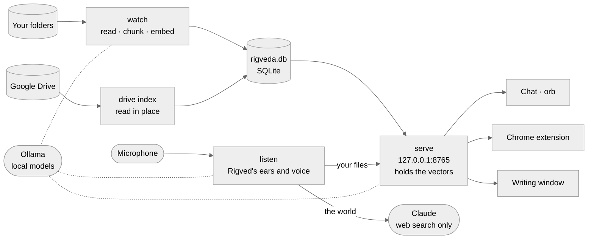
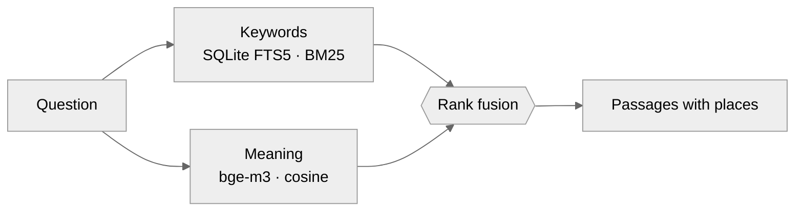
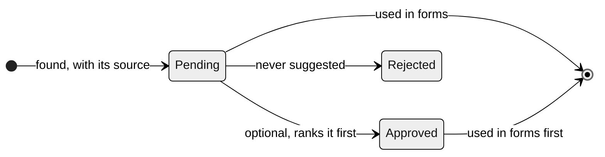
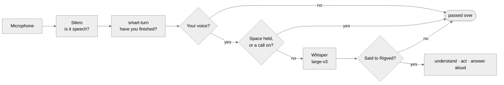

# Architecture

Rigveda is a private assistant over your own files. It reads the folders you choose and your Google Drive, remembers what they say, and uses that memory in four ways: it answers questions, it fills in web forms, it helps you write, and it talks with you as Rigved, a voice that is always listening for you. Everything about you is handled on one computer. No document, fact from your files or keystroke leaves the machine.

One thing does leave, by choice: when `claude_model` is set, questions about the world ("what's the news in London?", "who's India's T20 captain?") and plain conversation go to Claude, so they get a better answer than a local model can give. What goes is what you said and the recent conversation, never a file or anything answered from one. See [Two minds](#two-minds).

The design follows from that promise. There is one process that reads, one that serves, one that listens, one database file, and a local model server. Each can be understood on its own.

## The shape of it

**`rigveda watch`** follows the folders and keeps the index current. **`rigveda drive index`** reads Google Drive in place, when you run it. **`rigveda serve`** answers everything else, and **`rigveda listen`** is Rigved. Each runs as a user service under systemd, so they start with the session and restart when they fail. Watch and serve talk only through the database; the listener asks the server for the nearest passages (`POST /api/nearest`, loopback only), since the server already holds every vector in memory.

## Reading

Every file becomes plain text with a sense of place. A PDF page, a slide, a spreadsheet sheet, a minute of a video: each piece of text carries a *location*, so an answer can say `deck.pptx (slide 4)` or `talk.mp4 @ 12:30` rather than just a filename.

| Kind | How it is read |
|---|---|
| Text, Markdown, code | as is |
| PDF | the text layer; scanned pages through the vision model |
| Slides, spreadsheets | slide by slide, sheet by sheet |
| Images | the vision model transcribes any writing and describes the rest |
| Audio, video | Whisper on the GPU, with timestamps |

The text is cut into overlapping chunks of about 1,200 characters, so a sentence on a boundary is never lost. Each chunk goes into a full-text index and is embedded by `bge-m3` into a vector. A file is read again only when its size, modification time or extractor version changes. The watcher waits three seconds after a change, so a file still being copied is not read half-written.

## Finding

Two searches run side by side and their results are merged.

Keyword search finds exact names, numbers and rare words. Meaning search finds the passage that says *monthly rent* when you asked about *what I pay each month*. Reciprocal rank fusion combines the two lists by position rather than score, since the scores aren't comparable. Meaning counts twice as much as keywords, a weighting tuned on real questions about a lease. Vectors are kept in SQLite and compared in NumPy, with no vector database. With Google Drive that is about 4.9 million chunks, so the server loads them once into one float32 matrix (about 19 GB, read in the background in about 25 seconds) and a search is a single matrix product, about 0.4 seconds. Only the server holds them: a copy in each process once took the listener to 61 GB.

## Remembering who you are

Form filling needs facts, not passages. A second pass reads each new document for details about one person, the owner, whose name you set once. It looks for your name, date of birth, addresses, phone, passport and so on, and it is strict:

- The model must quote the words a fact came from, and the quote and the value must both appear in the text. Invented values fail this check.
- Passages that do not name you are never read, so a landlord's or parent's details are not mistaken for yours.
- A redacted number, a birth date in the last ten years, or a name without your first name is discarded.

Facts are suggested in forms as soon as they are found; you don't have to confirm anything. The review page at `/facts` is optional: approving a fact puts it first, and rejecting one stops it being suggested. A rejected fact stays rejected when it turns up again. A fact that appears in several files is stored once, with every source attached.

## Filling forms

The Chrome extension watches for focus on form fields. For each field it collects what a person would read: the label, the placeholder, the name and the nearby text. It sends these to the server, which decides what the field is asking for. The browser's own `autocomplete` hints come first, then patterns over the visible label.

The answer is shaped to the field. A date becomes `03/30/1996`, `30/03/1996` or ISO, whichever the field expects. A state dropdown gets `WA` or `Washington`, whichever option exists. Every part of an address comes from the same, newest home, so the street and the city never come from different places.

Some fields are never filled: passwords, one-time codes, card numbers, and fields about other people, such as a father's name or an emergency contact. The extension never submits a form.

## Writing

Press Alt+Shift+R in a text box and Rigveda drafts an answer to the box's question, or continues your sentence where the cursor is. Outside the browser, Super+Alt+R opens a small window that does the same and offers a Copy button. GNOME on Wayland lets no app type into another app's text boxes, so copying is the closest it can get.

Early drafts showed what goes wrong without limits. One described couples therapy as the owner's job, because film subtitles sat in the Downloads folder. So the rules are narrow. Only passages that mention you are offered to the model, and recordings never are. A detail the files don't give becomes a `[placeholder]`. Any ID number in the output is removed. The model returns its text together with the passages it actually used, and only those files are shown as sources.

## Listening

Rigved listens all the time, for you, and answers what you say to it without needing its name. Most of the work is deciding what *not* to answer.

- **Turns.** Silero finds speech in 32 ms frames. A short pause ends your turn if smart-turn, a small model, thinks you sound finished; a longer one ends it if you sound mid-sentence.
- **Your voice.** Each turn is turned into a CAM++ speaker fingerprint. A small logistic model, trained on the fingerprint plus how loud the speech is, gives the chance that it's you. Loudness matters: on the headset you speak at −14 to −7 dBFS, while a film reaches it at −34 to −16. Held out, it misses you 5% of the time and takes someone else for you 1.4%. The bar is 0.45, a little above the 0.44 that Rigved's own voice once scored coming back through the TV. When nothing is playing sound, PipeWire shows every output stream idle and the bar drops to 0.2: the TV can't be talking, so a soft one-second "play the movie" isn't lost.
- **Learning you.** Every turn is kept as a clip, private to you, in `~/.local/share/rigveda/voice/clips/` (the last 2,000 of each kind). Anything said while Space is held is you, so those clips label themselves. `rigveda listen --label` plays the rest for a yes or no, and `rigveda listen --train` refits the model, keeping it only if it beats the one before on held-out clips.
- **Not for Rigved.** Holding Space is dictation to Claude Code, so the listener reads the keyboard for Space held for over 0.35 s and ignores what was said meanwhile. It also ignores you while another app is recording, such as a call or a meeting.
- **Said to Rigved?** Speech in your voice can still be meant for someone else. "Pause", "louder" and other short commands are taken at once. Anything longer is put to the local model with the recent conversation: is this said to the assistant? It errs towards yes, because Space and the voice check have already filtered out most of what isn't.
- **Muting.** The orb's microphone button, or `$XDG_RUNTIME_DIR/rigveda-muted`, closes the microphone completely until you unmute it.

What Rigved can do is a fixed list: open, find a file, search, ask your files, talk, time, date, volume, music, forget, stop. Rules cover the common phrasings in microseconds, and the local model picks from the same list for the rest, so it can never run a command of its own. Volume is one of them. "Volume to 60%" sets the apps playing sound, such as VLC or the browser, never the speakers: they stay at 100% so Rigved is always heard in full, and if they had been turned down, that level is moved into the apps first so nothing jumps.

Rigved speaks with Kokoro and pauses what was playing while it talks. Talking over it stops it, unless it's only hearing its own voice.

## Two minds

Every question Rigved hears goes one of two ways.

| Question | Answered by | What leaves the computer |
|---|---|---|
| About you: anything with *I*, *my*, *we*, *our*. "What's my lease deposit?", "When was my H-1B receipt issued?" | the local model, from passages of your files and Drive | nothing |
| About the world, or conversation: "What's the news in London?", "How are you?" | Claude, through Claude Code on your plan | what you said, and recent turns that weren't answered from your files |
| Neither is sure | Claude, which replies `FILES` when only your documents could answer, and it's answered locally | the question only |

Claude runs as `claude -p` in an empty folder with no settings, no MCP servers and one tool, web search, so it cannot read or change anything on this computer. It runs at low effort with thinking off, and is told to search once with the month and year in the query, since results are often months old. A reply takes about 3 seconds, or about 10 with a search. For news, the listener fetches today's BBC headlines itself, sending only the feed's address, and hands them over with the question, so the answer is about today and needs no search. Asides about searching or sources are cut before anything is spoken. If Claude can't be reached, the local model answers instead.

The conversation is shared by voice, the orb's chat and its file chat: the last six exchanges, forgotten after ten quiet minutes. Turns answered from your files are marked private. The local model sees them, so "and my mother's name?" works as a follow-up, but they are left out of what Claude is given.

## Trust boundaries

The server listens only on `127.0.0.1`. Three checks keep other software out:

| Threat | Defense |
|---|---|
| A website points its own domain at 127.0.0.1 (DNS rebinding) | Requests must carry a loopback `Host` header |
| A website posts a hidden form to the local server | Only `application/json` is accepted, which browsers won't send across sites without asking, and the server never agrees |
| Another program asks for your personal details | Form suggestions need a 256-bit token from `~/.config/rigveda/token` (mode 0600), held only by the extension's background worker |
| Your files reach Claude | Questions about you are answered locally; turns answered from files are left out of Claude's conversation; Claude has web search and nothing else, in an empty folder |
| The TV, or someone else, gives Rigved orders | Your voice must match, more strictly while something is playing; Space or another app recording means it wasn't for Rigved; it can only take actions from a fixed list |

Inside the extension, the suggestion list is drawn in a closed shadow root, so the page can neither style it nor read it. Only real key presses can accept a suggestion; a page's script cannot fake a Tab and then read the value it filled.

## One file

Everything Rigveda knows lives in `~/.local/share/rigveda/rigveda.db`:

| Table | Holds |
|---|---|
| `documents` | each file: path, size, time, kind, extractor version |
| `chunks`, `chunks_fts` | the text and its full-text index |
| `embeddings` | one vector per chunk, tagged with the model that made it |
| `facts`, `fact_sources` | your details, their status, and where each was found |
| `drive_files` | every Google Drive file and how far it got: indexed, empty, skipped or failed |

Deleting a file removes its chunks, its vectors and any pending facts found only in it. Facts you approved or rejected are kept, because you decided on them. To back up Rigveda, copy that one file. To start over, delete it.

Rigved keeps a little outside it, all readable only by you: your voice clips and trained voice model under `~/.local/share/rigveda/voice/`, what you said and heard in `voice-history.jsonl` (the last 1,000), and the current conversation in `$XDG_RUNTIME_DIR`, which is gone at logout.

## Models

| Role | Model | Why this one |
|---|---|---|
| Answers, facts, writing | `qwen3:14b` | strong at following rules and producing structured output; fits beside the others in 32 GB of video memory |
| Meaning | `bge-m3` | multilingual and accurate for retrieval |
| Images, scans | `qwen2.5vl:7b` | reads text in photos and scanned pages |
| Speech | Whisper `large-v3` | accurate timestamps for long recordings, and what you say to Rigved |
| Is it speech, have you finished | Silero VAD, smart-turn v3 | small and fast enough to run on every 32 ms of sound |
| Is it you | CAM++ (sherpa-onnx) + your own logistic model | the only one of five speaker models tried that told you from a film on the TV |
| Rigved's voice | Kokoro | natural and quick, with American, British and Indian voices |
| The world, conversation | Claude Sonnet 5.5, through Claude Code | optional; only what isn't about you |

All but Claude run on this computer, through Ollama, faster-whisper or ONNX Runtime. Fact extraction and writing ask for JSON that matches a schema and skip the model's thinking step, which keeps a draft to about a second.

## Next

Phase 6 brings Rigveda to the phone without opening it to the internet. A private Tailscale network will connect your devices, a token will be required for every request, and Rigveda will become an installable web app with a Siri Shortcut. The server stays on this computer, and so do your files.
