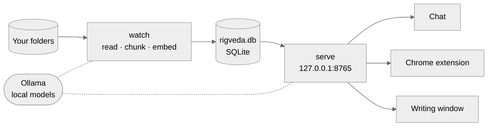
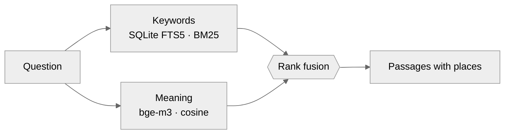
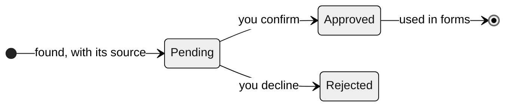

# Architecture

Rigveda is a private assistant over your own files. It reads the folders you choose, remembers what they say, and uses that memory in three ways: it answers questions, it fills in web forms, and it helps you write. All of it runs on one computer. No document, fact or keystroke leaves the machine.

The design follows from that promise. There is one process that reads, one process that serves, one database file, and a local model server. Each can be understood on its own.

## The shape of it

**`rigveda watch`** follows the folders and keeps the index current. **`rigveda serve`** answers everything else. Both run as user services under systemd, so they start with the session and restart when they fail. They talk to each other only through the database.

## Reading

Every file becomes plain text with a sense of place. A PDF page, a slide, a spreadsheet sheet, a minute of a video: each piece of text carries a *location*, so an answer can say `deck.pptx (slide 4)` or `talk.mp4 @ 12:30` rather than just a filename.

| Kind | How it is read |
|---|---|
| Text, Markdown, code | as is |
| PDF | the text layer; scanned pages through the vision model |
| Slides, spreadsheets | slide by slide, sheet by sheet |
| Images | the vision model transcribes any writing and describes the rest |
| Audio, video | Whisper on the GPU, with timestamps |

The text is cut into overlapping chunks of about 1,200 characters, so a sentence on a boundary is never lost. Each chunk goes into a full-text index and is embedded by `bge-m3` into a vector. A file is read again only when its size, modification time or extractor version changes. The watcher waits three seconds after a change, so a file still being copied is not read half-written.

## Finding

Two searches run side by side and their results are merged.

Keyword search finds exact names, numbers and rare words. Meaning search finds the passage that says *monthly rent* when you asked about *what I pay each month*. Reciprocal rank fusion combines the two lists by position rather than score, since the scores aren't comparable. Meaning counts twice as much as keywords, a weighting tuned on real questions about a lease. Vectors are kept in SQLite and compared in NumPy; at the scale of one person's files that takes milliseconds, so there is no vector database.

## Remembering who you are

Form filling needs facts, not passages. A second pass reads each new document for details about one person, the owner, whose name you set once. It looks for your name, date of birth, addresses, phone, passport and so on, and it is strict:

- The model must quote the words a fact came from, and the quote and the value must both appear in the text. Invented values fail this check.
- Passages that do not name you are never read, so a landlord's or parent's details are not mistaken for yours.
- A redacted number, a birth date in the last ten years, or a name without your first name is discarded.

Nothing is used until you approve it on the review page at `/facts`. A rejected fact stays rejected when it turns up again. A fact that appears in several files is stored once, with every source attached.

## Filling forms

The Chrome extension watches for focus on form fields. For each field it collects what a person would read: the label, the placeholder, the name and the nearby text. It sends these to the server, which decides what the field is asking for. The browser's own `autocomplete` hints come first, then patterns over the visible label.

The answer is shaped to the field. A date becomes `03/30/1996`, `30/03/1996` or ISO, whichever the field expects. A state dropdown gets `WA` or `Washington`, whichever option exists. Every part of an address comes from the same, newest home, so the street and the city never come from different places.

Some fields are never filled: passwords, one-time codes, card numbers, and fields about other people, such as a father's name or an emergency contact. The extension never submits a form.

## Writing

Press Alt+Shift+R in a text box and Rigveda drafts an answer to the box's question, or continues your sentence where the cursor is. Outside the browser, Super+Alt+R opens a small window that does the same and offers a Copy button. GNOME on Wayland lets no app type into another app's text boxes, so copying is the closest it can get.

Early drafts showed what goes wrong without limits. One described couples therapy as the owner's job, because film subtitles sat in the Downloads folder. So the rules are narrow. Only passages that mention you are offered to the model, and recordings never are. A detail the files don't give becomes a `[placeholder]`. Any ID number in the output is removed. The model returns its text together with the passages it actually used, and only those files are shown as sources.

## Trust boundaries

The server listens only on `127.0.0.1`. Three checks keep other software out:

| Threat | Defense |
|---|---|
| A website points its own domain at 127.0.0.1 (DNS rebinding) | Requests must carry a loopback `Host` header |
| A website posts a hidden form to the local server | Only `application/json` is accepted, which browsers won't send across sites without asking, and the server never agrees |
| Another program asks for your personal details | Form suggestions need a 256-bit token from `~/.config/rigveda/token` (mode 0600), held only by the extension's background worker |

Inside the extension, the suggestion list is drawn in a closed shadow root, so the page can neither style it nor read it. Only real key presses can accept a suggestion; a page's script cannot fake a Tab and then read the value it filled.

## One file

Everything Rigveda knows lives in `~/.local/share/rigveda/rigveda.db`:

| Table | Holds |
|---|---|
| `documents` | each file: path, size, time, kind, extractor version |
| `chunks`, `chunks_fts` | the text and its full-text index |
| `embeddings` | one vector per chunk, tagged with the model that made it |
| `facts`, `fact_sources` | your details, their status, and where each was found |

Deleting a file removes its chunks, its vectors and any pending facts found only in it. Facts you approved or rejected are kept, because you decided on them. To back up Rigveda, copy that one file. To start over, delete it.

## Models

| Role | Model | Why this one |
|---|---|---|
| Answers, facts, writing | `qwen3:14b` | strong at following rules and producing structured output; fits beside the others in 32 GB of video memory |
| Meaning | `bge-m3` | multilingual and accurate for retrieval |
| Images, scans | `qwen2.5vl:7b` | reads text in photos and scanned pages |
| Speech | Whisper `large-v3` | accurate timestamps for long recordings |

All of them run through Ollama or faster-whisper on the local GPU. Fact extraction and writing ask for JSON that matches a schema and skip the model's thinking step, which keeps a draft to about a second.

## Next

Phase 6 brings Rigveda to the phone without opening it to the internet. A private Tailscale network will connect your devices, a token will be required for every request, and Rigveda will become an installable web app with a Siri Shortcut. The server stays on this computer, and so do your files.
